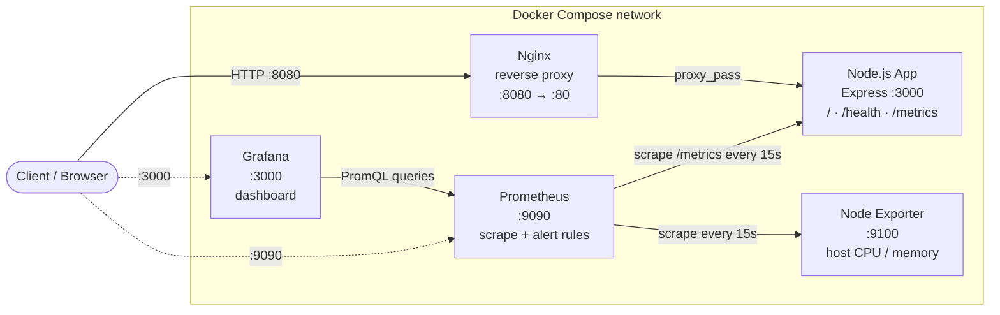
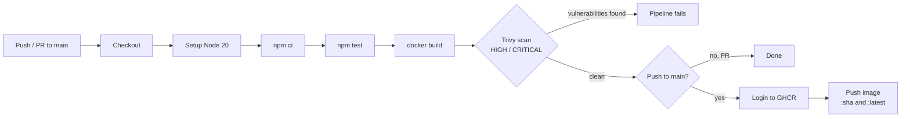
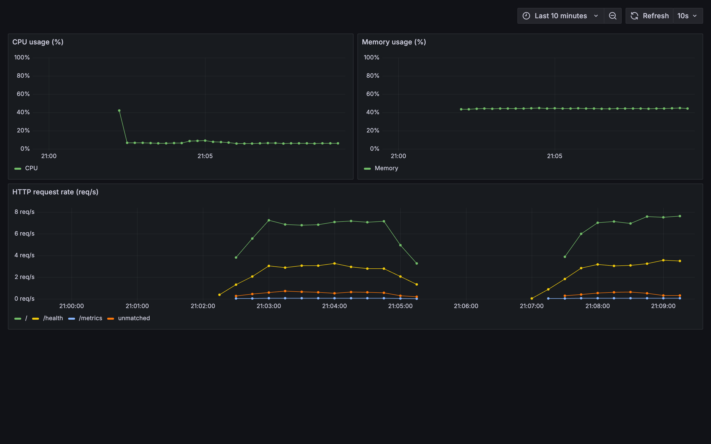
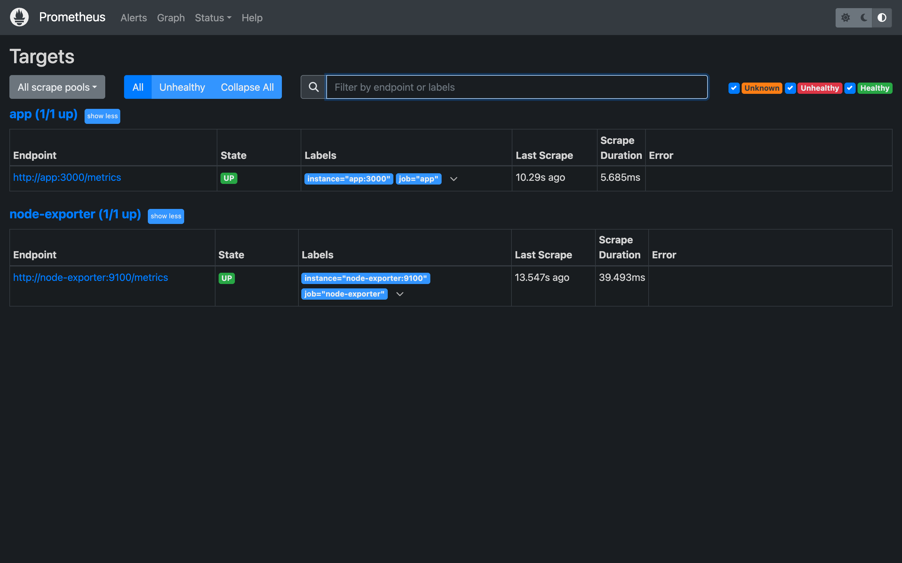
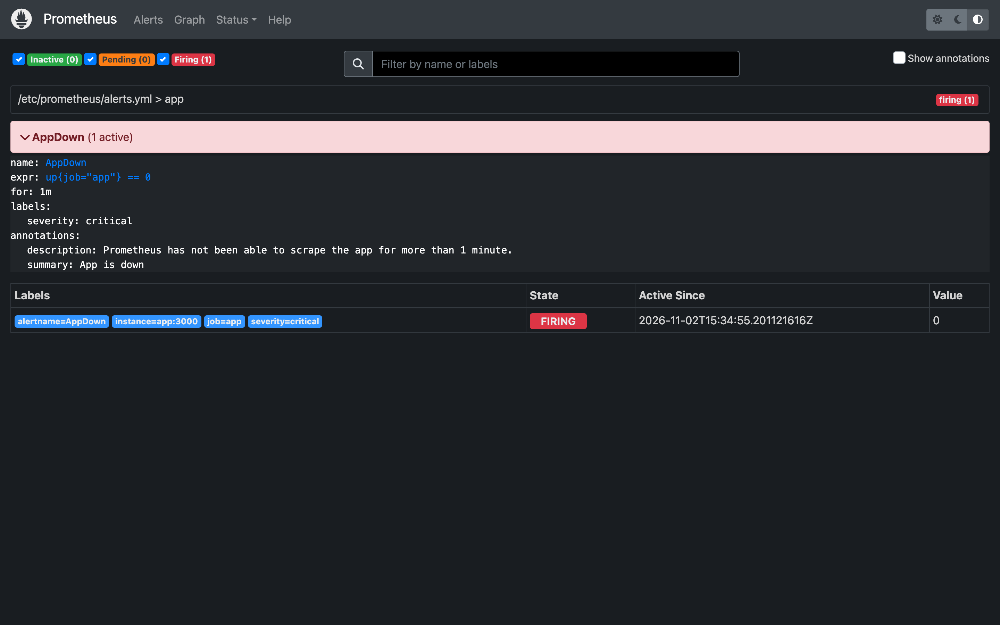
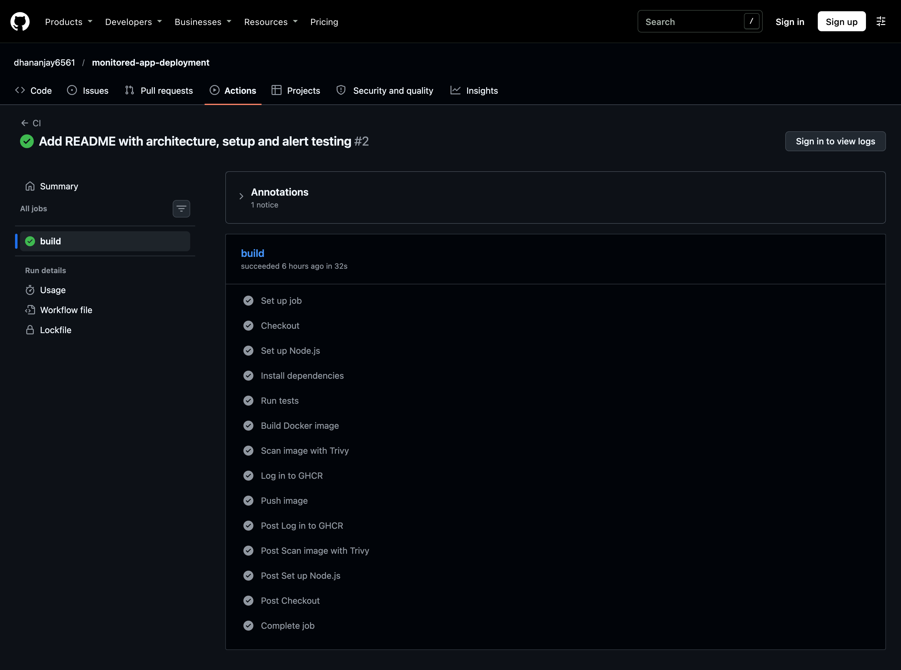

# Monitored App Deployment with CI/CD

[](https://github.com/dhananjay6561/monitored-app-deployment/actions/workflows/ci.yml)


A small Node.js (Express) API, containerised with Docker and run behind an Nginx reverse proxy, with full observability: Prometheus scrapes application and host metrics, an alert fires when the app goes down, and Grafana shows a pre-provisioned dashboard. Every push runs a GitHub Actions pipeline that tests the code, builds the image, scans it for vulnerabilities with Trivy, and publishes it to GitHub Container Registry. The whole stack starts with a single `docker compose up -d`.

---

## Architecture



The app has no published port. It can only be reached through Nginx (or by Prometheus inside the Docker network).

### CI/CD pipeline



---

## Tech stack

| Layer | Tool | Purpose |
|---|---|---|
| Application | Node.js 20, Express | REST API with health and metrics endpoints |
| Metrics library | prom-client | Exposes default Node.js metrics and a request counter |
| Testing | Jest, supertest | Endpoint tests run in CI |
| Container | Docker (`node:20-alpine`) | Non-root image with a built-in healthcheck |
| Reverse proxy | Nginx 1.27 | Single public entrypoint on port 8080 |
| Metrics & alerting | Prometheus 2.55 | Scrapes targets, evaluates the `AppDown` rule |
| Host metrics | Node Exporter 1.8 | CPU and memory of the Docker host |
| Dashboards | Grafana 11.3 | Datasource and dashboard provisioned from files |
| CI/CD | GitHub Actions | Test, build, scan, publish |
| Security scanning | Trivy | Fails the build on fixable HIGH/CRITICAL CVEs |
| Registry | GitHub Container Registry | Stores the published images |

---

## Project structure

```
.
├── .github/workflows/ci.yml        # CI/CD pipeline
├── app/
│   ├── app.js                      # Express routes + Prometheus metrics
│   ├── server.js                   # Starts the HTTP server
│   ├── tests/app.test.js           # Jest + supertest tests
│   ├── Dockerfile
│   ├── .dockerignore
│   ├── package.json
│   └── package-lock.json
├── nginx/nginx.conf                # Reverse proxy to app:3000
├── prometheus/
│   ├── prometheus.yml              # Scrape targets
│   └── alerts.yml                  # AppDown alert rule
├── grafana/provisioning/
│   ├── datasources/datasource.yml  # Prometheus datasource
│   └── dashboards/
│       ├── dashboards.yml          # Dashboard loader
│       └── app-overview.json       # CPU, memory, request rate panels
├── docs/screenshots/              # Images used in this README
├── docker-compose.yml
└── README.md
```

---

## Getting started

### Prerequisites

- Docker with Docker Compose v2
- Node.js 20 (only needed to run the tests locally)

### Run the stack

```bash
git clone https://github.com/dhananjay6561/monitored-app-deployment.git
cd monitored-app-deployment
docker compose up -d
docker compose ps        # all services should be "Up", app should be "healthy"
```

### Access the services

| Service | URL | Notes |
|---|---|---|
| App (via Nginx) | http://localhost:8080 | The only way to reach the app |
| Health check | http://localhost:8080/health | Returns `{"status":"ok"}` |
| App metrics | http://localhost:8080/metrics | Prometheus text format |
| Prometheus | http://localhost:9090 | Check **Status → Targets** |
| Grafana | http://localhost:3000 | Login `admin` / `admin`, then open **Dashboards → App Overview** |

### Run the tests locally

```bash
cd app
npm ci
npm test
```

### Stop the stack

```bash
docker compose down
```

---

## API endpoints

| Method | Path | Response |
|---|---|---|
| GET | `/` | `{"message":"Hello from the monitored app"}` |
| GET | `/health` | `{"status":"ok"}` with HTTP 200 |
| GET | `/metrics` | Default Node.js metrics + `http_requests_total{route, status_code}` |

---

## Monitoring

**Prometheus** scrapes two targets every 15 seconds:

- `app` → `app:3000/metrics`
- `node-exporter` → `node-exporter:9100/metrics`

**Grafana** loads the Prometheus datasource and the *App Overview* dashboard automatically on startup. The dashboard has three panels:

| Panel | PromQL |
|---|---|
| CPU usage (%) | `100 - (avg(rate(node_cpu_seconds_total{mode="idle"}[1m])) * 100)` |
| Memory usage (%) | `(1 - node_memory_MemAvailable_bytes / node_memory_MemTotal_bytes) * 100` |
| HTTP request rate | `sum by (route) (rate(http_requests_total[1m]))` |

**Alerting**: one rule, `AppDown`, fires with severity `critical` when `up{job="app"} == 0` for more than 1 minute.

---

## How I tested the alert

1. Confirm the alert is inactive. Open http://localhost:9090/alerts and `AppDown` should be green (inactive).
2. Stop the app container:
   ```bash
   docker compose stop app
   ```
3. Within about 15 seconds (one scrape), the alert turns **Pending** (yellow). Prometheus has seen the target down but the `for: 1m` window has not passed yet.
4. After more than 1 minute, refresh the **Alerts** tab. `AppDown` is now **Firing** (red).
5. Bring the app back:
   ```bash
   docker compose start app
   ```
   On the next scrape the target is back to **UP** and the alert returns to inactive. Nginx reconnects on its own because it re-resolves the `app` hostname through Docker's DNS.

Observed result: pending at about 20s, firing at about 80s, and `curl localhost:8080/health` returned 200 again straight after the restart.

---

## Security

- The container runs as the non-root `node` user.
- The app has no published port and is only reachable through Nginx.
- Trivy scans every image in CI and fails the build on fixable HIGH or CRITICAL vulnerabilities.
- The Trivy action is pinned to a commit SHA, so the pipeline cannot pick up a changed tag.
- The `GITHUB_TOKEN` gets least-privilege permissions (`contents: read`, `packages: write`), and images are only pushed on `main`, never from pull requests.

**What the scan caught.** The first Trivy scan of the plain `node:20-alpine` image reported 26 HIGH/CRITICAL vulnerabilities and none of them were in the app's own dependencies. 22 were in packages bundled with the npm CLI that ships inside the base image (`tar`, `minimatch`, `cross-spawn`, `glob` and others), and 4 were in Alpine's OpenSSL. The fix was in the Dockerfile, not an ignore file: npm is only needed to install dependencies, so it is removed from the runtime image, and `apk upgrade` pulls the patched OpenSSL. The rescan reported 0.

---

## What I would add in production

- **Orchestration**: Kubernetes or a managed service (ECS, Cloud Run) for scaling, rolling deploys and self-healing.
- **Alert routing**: Alertmanager sending notifications to Slack or email, instead of only showing alerts in the Prometheus UI.
- **Secrets management**: a secrets manager (Vault, AWS Secrets Manager) instead of default credentials like Grafana's `admin/admin`.
- **Persistent volumes**: for Prometheus and Grafana data so metrics history and dashboard changes survive restarts.
- **TLS on Nginx**: HTTPS with certificates from Let's Encrypt.

---

## Screenshots

### Grafana: App Overview dashboard
CPU and memory from Node Exporter, request rate per route from the app. The gap in the request-rate panel is the app being stopped during the alert test.



### Prometheus: both targets UP



### Prometheus: AppDown alert firing
Taken after the app container had been stopped for more than 1 minute.



### GitHub Actions: pipeline run
Tests, image build, Trivy scan and push to GHCR all passing.


